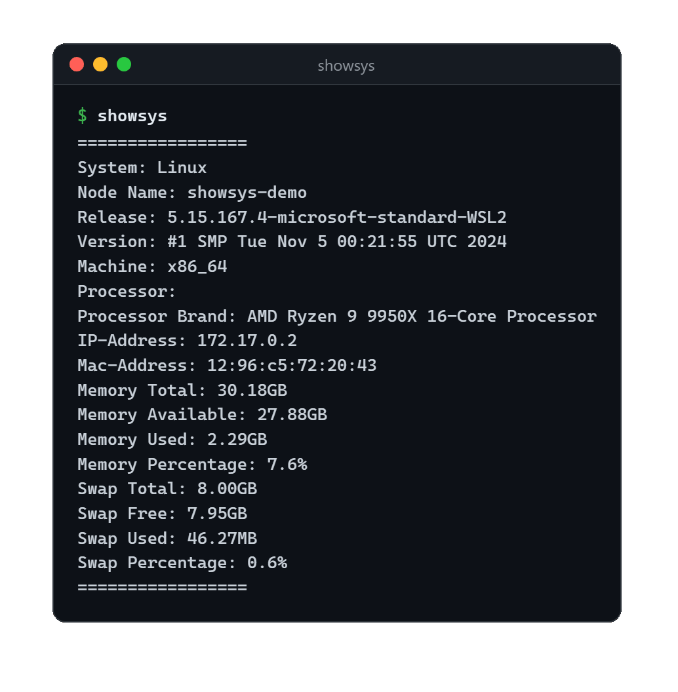
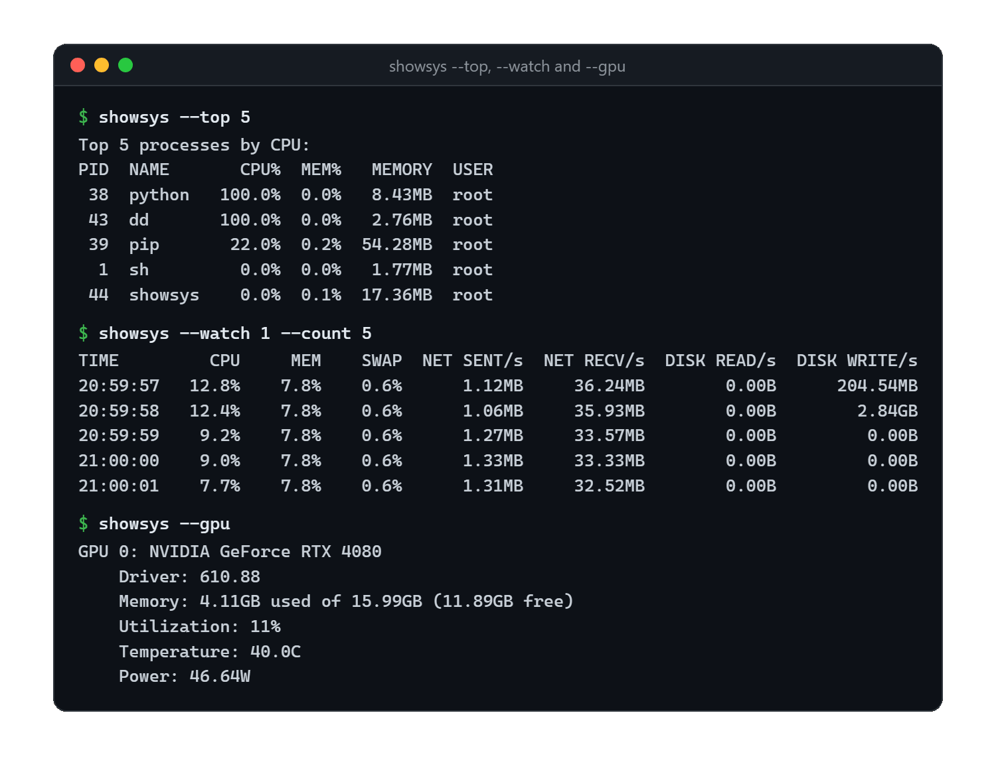

# ShowSys

[](https://github.com/NatLee/show-system-info/actions/workflows/test.yml)
[](https://github.com/NatLee/show-system-info/actions/workflows/release.yml)
[](https://pypi.org/project/ShowSys/)
[](https://pypi.org/project/ShowSys/)
[](LICENSE)

**"What is this machine?" in one command.** ShowSys prints the operating system, CPU, memory, swap,
network, disks, sensors, the busiest processes and NVIDIA GPUs, as text you can read or JSON your
scripts can use. It also has a live mode and a Python API. It works the same on Linux, Windows and
macOS, and when the OS doesn't report something, it says `N/A` instead of crashing.



## Install

```bash
pip install showsys
```

Optional, for NVIDIA GPUs (`--gpu`):

```bash
pip install "showsys[gpu]"
```

ShowSys needs Python 3.7 or newer. The only dependencies are [psutil](https://github.com/giampaolo/psutil)
and [py-cpuinfo](https://github.com/workhorsy/py-cpuinfo); the `gpu` extra adds NVIDIA's
[nvidia-ml-py](https://pypi.org/project/nvidia-ml-py/).

> Everything marked *1.1* below needs ShowSys 1.1.0 or newer (`pip install -U showsys`).

## Quick start

```bash
showsys              # summary: system, memory and swap
showsys -d           # details: adds boot time, CPU and network
showsys --all        # everything, including disks, sensors, top processes and GPUs
showsys --json       # the summary as JSON
showsys --watch      # live CPU, memory, network and disk rates, every second (Ctrl+C to stop)
```



## Command-line options

Pick one section. Without one, `showsys` prints the summary.

| Option | Shows |
|---|---|
| *(none)* | Summary: system, memory and swap |
| `-d`, `--details` | System, boot time, CPU, memory, swap and network |
| `-b`, `--boot_time` | Boot time |
| `-m`, `--memory` | Memory |
| `-s`, `--swap` | Swap |
| `-c`, `--cpu` | Cores, frequencies, and usage per core measured over one second |
| `-n`, `--network` | Network interfaces with their IPv4 and MAC addresses, and total traffic |
| `-a`, `--all` *1.1* | `--details` plus disks, sensors, top processes and GPUs |
| `--disk` *1.1* | Partitions with their usage, and bytes read and written since boot |
| `--sensors` *1.1* | Temperatures, fans and battery |
| `--top [N]` *1.1* | The N busiest processes (default 5), measured over one second |
| `--gpu` *1.1* | NVIDIA GPUs: memory, utilization, temperature, power (needs `showsys[gpu]`) |

If you pass several sections, the first one in this table wins, as it always has.

| Option | Does |
|---|---|
| `-j`, `--json` *1.1* | Print JSON instead of text. Works with every section and with `--watch` |
| `--sort {cpu,memory}` *1.1* | Order the processes of `--top` and `--all` (default `cpu`) |
| `-w`, `--watch [SECONDS]` *1.1* | Print a line of live readings every SECONDS (default 1) until Ctrl+C |
| `--count N` *1.1* | Stop `--watch` after N readings |
| `-V`, `--version` *1.1* | Print the version |
| `-h`, `--help` | List the options |

`python -m showsys` works like the `showsys` command, which helps when the scripts folder is not on `PATH`.

### Live mode

`--watch` prints one line per reading. Each line covers the time since the previous one, so the rates
are per second over that window:

```text
$ showsys --watch 1 --count 5
TIME         CPU     MEM    SWAP  NET SENT/s  NET RECV/s  DISK READ/s  DISK WRITE/s
20:59:57   12.8%    7.8%    0.6%      1.12MB     36.24MB        0.00B      204.54MB
20:59:58   12.4%    7.8%    0.6%      1.06MB     35.93MB        0.00B        2.84GB
20:59:59    9.2%    7.8%    0.6%      1.27MB     33.57MB        0.00B         0.00B
21:00:00    9.0%    7.8%    0.6%      1.33MB     33.33MB        0.00B         0.00B
21:00:01    7.7%    7.8%    0.6%      1.31MB     32.52MB        0.00B         0.00B
```

With `--json` you get one JSON object per line ([JSON Lines](https://jsonlines.org/)), ready to append
to a log file:

```bash
showsys --watch 1 --json >> metrics.jsonl
```

```json
{"timestamp": "2026-11-03T21:00:02+08:00", "interval_seconds": 1.0, "cpu_percent": 9.3, "memory_percent": 7.8, "swap_percent": 0.6, "net_sent_per_sec": 1272933.6, "net_recv_per_sec": 36152602.1, "disk_read_per_sec": 0.0, "disk_write_per_sec": 0.0}
```

## JSON output

`--json` prints the same sections as the text, with plain numbers instead of formatted strings:

```text
$ showsys --memory --json
{
  "timestamp": "2026-11-03T20:59:53+08:00",
  "memory": {
    "total": 32400801792,
    "available": 29939556352,
    "used": 2461245440,
    "free": 13936041984,
    "percent": 7.6
  }
}
```

- Sizes are bytes, frequencies MHz, temperatures degrees Celsius, percentages 0 to 100.
- A value the OS doesn't report is `null`. In `sensors`, an empty list means "supported here, but none found".
- `timestamp` is the local time when the collection started.
- The sections are `system`, `boot`, `cpu`, `memory`, `swap`, `network`, `disk`, `sensors`,
  `processes` and `gpu`. `showsys --all --json` has all of them.
- If something goes wrong, the error goes to stderr, so stdout never holds half a document.

For example, the memory use in a shell script:

```bash
showsys -m --json | python -c "import json, sys; print(json.load(sys.stdin)['memory']['percent'])"
```

## Python API

### Numbers: `collect()` and the `get_*()` functions *1.1*

`collect()` returns the same data as `--json`, as dicts:

```python
import showsys

data = showsys.collect('cpu', 'memory')   # no names: every section
print(data['cpu']['usage_percent'], data['memory']['percent'])
```

Each section also has a function that returns a typed record (a dataclass with `to_dict()`):

```python
import showsys

cpu = showsys.get_cpu(interval=0.5)        # measure usage over half a second
print(cpu.logical_cores, cpu.freq_current_mhz, cpu.usage_percent)

for process in showsys.get_processes(limit=3, sort_by='memory'):
    print(process.pid, process.name, process.memory_rss)

for rates in showsys.watch(interval=1, count=3):
    print(rates.cpu_percent, rates.net_recv_per_sec)
```

| Function | Returns |
|---|---|
| `get_system()` | OS, host name, CPU name, IP and MAC address, Python version |
| `get_boot()` | Boot time, as a timestamp and in ISO 8601, and the uptime |
| `get_cpu(interval=1.0)` | Core counts, frequencies, usage per core and in total, load average (Unix) |
| `get_memory()`, `get_swap()` | Totals and use, in bytes |
| `get_network()` | Interfaces with IPv4, IPv6 and MAC addresses, link state, speed and MTU; bytes sent and received |
| `get_disks()` | Partitions with their usage; bytes read and written |
| `get_sensors()` | Temperatures, fans and battery |
| `get_processes(limit=5, sort_by='cpu', interval=1.0)` | The busiest processes |
| `get_gpus()` | NVIDIA GPUs, or `None` without the `gpu` extra or an NVIDIA driver |
| `collect(*sections, interval=1.0, top=5, sort_by='cpu')` | Several sections as JSON-ready dicts |
| `watch(interval=1.0, count=None)` | A live reading every `interval` seconds |

The package ships type hints (`py.typed`), so your editor and mypy know every field.

### Display strings: `ShowSys`

The original API is still here and prints exactly what it always did:

```python
from showsys import ShowSys

sysinfo = ShowSys()
sysinfo.info()
```

`info()` prints a summary (system, memory and swap) and `detail_info()` prints everything that `-d`
shows. Both also return the text; pass `show=False` to get the text without printing it.

These methods return dicts of display strings: `system_information()`, `boot_time()`, `cpu_info()`,
`memory_info()`, `swap_info()`, `network_info()` and `disk_info()`. For example:

```python
from showsys import ShowSys

sysinfo = ShowSys()
print(sysinfo.cpu_info())
```

```python
{
    'Physical cores': 12,
    'Total cores': 20,
    'Max Frequency': '2100.00Mhz',
    'Min Frequency': '0.00Mhz',
    'Current Frequency': '2100.00Mhz',
    'CPU Usage Per Core': ['0.0%', '0.0%', '0.0%', '0.0%', '0.0%', '1.6%', '0.0%', '0.0%', '0.0%', '15.4%', '3.1%', '0.0%', '1.6%', '0.0%', '0.0%', '0.0%', '0.0%', '0.0%', '0.0%', '0.0%'],
    'Total CPU Usage': '1.6%'
}
```

## What `N/A` means

Not every OS reports everything. ShowSys shows `N/A` (`null` in JSON) for what's missing and carries on.

| | Linux | Windows | macOS |
|---|---|---|---|
| CPU frequency | Most machines; not some ARM boards and VMs | Yes | Intel Macs; not Apple Silicon |
| Load average (`get_cpu()`, JSON) | Yes | No | Yes |
| Temperatures | Yes, where the hardware has sensors | No | No |
| Fans | Yes, where the hardware has sensors | No | No |
| Battery | Laptops | Laptops | Laptops |
| GPU (`showsys[gpu]`) | NVIDIA driver | NVIDIA driver | No |

A few more cases:

- The IP address shows `N/A` only when no network interface has a usable address (see below).
- Disk read and write totals are missing in some containers.
- `--top` leaves out processes the OS won't let you inspect, or shows `N/A` for their memory.

### Which IP address?

`IP-Address` (`ip_address` in JSON) is read from the network interfaces. There is no DNS lookup,
so it no longer depends on whether the host name resolves. The rule:

1. Candidates are the addresses of interfaces that are up, leaving out loopback (`127.0.0.1`, `::1`)
   and link-local (`169.254.x.x`, `fe80::`) addresses.
2. The candidate that the routing table uses for outbound traffic (the default route) wins. ShowSys
   asks the OS which source address a UDP socket would use; nothing is sent.
3. Without a default route, it takes the first candidate in the order the OS lists the interfaces.

IPv4 comes first; an IPv6 address is shown only when there is no usable IPv4 address.

## Development

```bash
git clone https://github.com/NatLee/show-system-info.git
cd show-system-info
pip install -e ".[test]"
pytest
```

- `tox -e py` also checks that the source distribution contains every tracked file.
- `pip install mypy types-psutil` and then `mypy src/showsys` checks the type hints (strict; settings in `setup.cfg`).

How the code is laid out:

| File | Does |
|---|---|
| `src/showsys/models.py` | The records (dataclasses) and their units |
| `src/showsys/collectors.py` | Reads the system into records: `get_*()`, `collect()` |
| `src/showsys/render.py` | Turns records into text, including the original `ShowSys` format |
| `src/showsys/live.py` | `watch()` for `--watch` |
| `src/showsys/showsys.py` | The original `ShowSys` class |
| `src/showsys/cli.py` | The `showsys` command |

The tests replace every system call with a fake machine (`tests/fakes.py`), so they can compare
output character by character. `tests/test_output_format.py` pins the text of every option from
version 1.0; if it fails, a change would break someone's script.

## License

[MIT](LICENSE)
